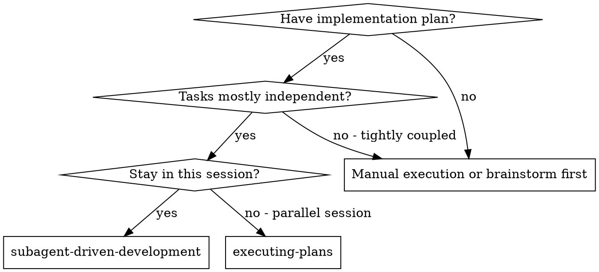
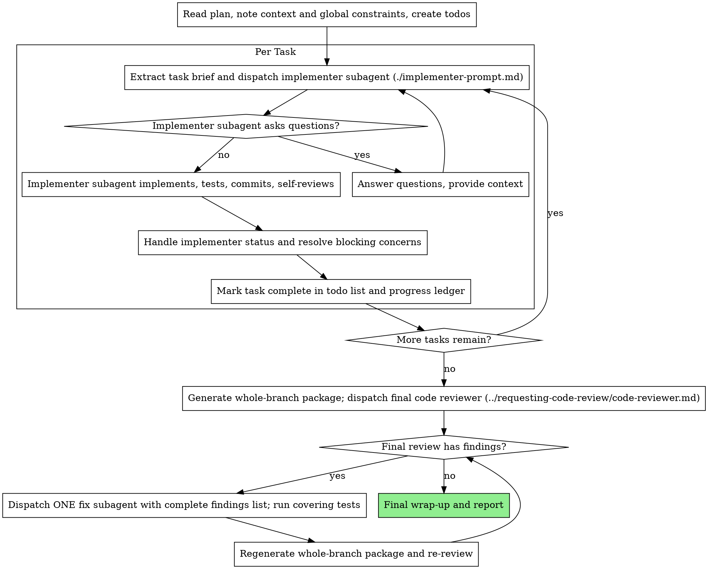

# Subagent-Driven Development

Execute plan by dispatching a fresh implementer subagent per task. Each implementer implements, tests, commits, and self-reviews. After all tasks are complete, dispatch one broad whole-branch review.

**Why subagents:** You delegate tasks to specialized agents with isolated context. By precisely crafting their instructions and context, you ensure they stay focused and succeed at their task. They should never inherit your session's context or history — you construct exactly what they need. This also preserves your own context for coordination work.

**Core principle:** Fresh subagent per task + implementer self-review + broad final review = low overhead with a final quality gate

**Narration:** between tool calls, narrate at most one short line — the
ledger and the tool results carry the record.

**Continuous execution:** Do not pause to check in with your human partner between tasks. Execute all tasks from the plan without stopping. The only reasons to stop are: BLOCKED status you cannot resolve, ambiguity that genuinely prevents progress, or all tasks complete. "Should I continue?" prompts and progress summaries waste their time — they asked you to execute the plan, so execute it.

## When to Use



**vs. Executing Plans (parallel session):**
- Same session (no context switch)
- Fresh subagent per task (no context pollution)
- Tasks proceed directly from implementation, testing, and self-review to completion
- One broad whole-branch review at the end
- Faster iteration with fewer subagent dispatches

## The Process



## Pre-Flight Plan Review

Before dispatching Task 1, scan the plan once for conflicts:

- tasks that contradict each other or the plan's Global Constraints
- anything the plan explicitly mandates that the review rubric treats as a
  defect (a test that asserts nothing, verbatim duplication of a logic block)

Present everything you find to your human partner as one batched question —
each finding beside the plan text that mandates it, asking which governs —
before execution begins, not one interrupt per discovery mid-plan. If the
scan is clean, proceed without comment. The final whole-branch review remains
the net for conflicts that only emerge from implementation.

## Model Selection

Use the least powerful model that can handle each role to conserve cost and increase speed.

**Mechanical implementation tasks** (isolated functions, clear specs, 1-2 files): use a fast, cheap model. Most implementation tasks are mechanical when the plan is well-specified.

**Integration and judgment tasks** (multi-file coordination, pattern matching, debugging): use a standard model.

**Architecture and design tasks**: use the most capable available model.
The final whole-branch review is one of these — dispatch it on the most
capable available model, not the session default.

**Review tasks**: choose the model with the same judgment, scaled to the
diff's size, complexity, and risk. A small mechanical diff does not need the
most capable model; a subtle concurrency change does.

**Always specify the model explicitly when dispatching a subagent.** An
omitted model inherits your session's model — often the most capable and
most expensive — which silently defeats this section.

**Turn count beats token price.** Wall-clock and context cost scale with how
many turns a subagent takes, and the cheapest models routinely take 2-3× the
turns on multi-step work — costing more overall. Use a mid-tier model as the
floor for reviewers and for implementers working from prose descriptions.
When the task's plan text contains the complete code to write, the
implementation is transcription plus testing: use the cheapest tier for
that implementer. Single-file mechanical fixes also take the cheapest tier.

**Task complexity signals (implementation tasks):**
- Touches 1-2 files with a complete spec → cheap model
- Touches multiple files with integration concerns → standard model
- Requires design judgment or broad codebase understanding → most capable model

## Handling Implementer Status

Implementer subagents report one of four statuses. Handle each appropriately:

**DONE:** Confirm the report contains commits, test evidence, and self-review results. Update the todo and progress ledger, then continue to the next task.

**DONE_WITH_CONCERNS:** The implementer completed the work but flagged doubts. Read the concerns before proceeding. Resolve correctness or scope concerns before marking the task complete. Record non-blocking observations in the progress ledger so the final reviewer can assess them in the whole-branch context.

**NEEDS_CONTEXT:** The implementer needs information that wasn't provided. Provide the missing context and re-dispatch.

**BLOCKED:** The implementer cannot complete the task. Assess the blocker:
1. If it's a context problem, provide more context and re-dispatch with the same model
2. If the task requires more reasoning, re-dispatch with a more capable model
3. If the task is too large, break it into smaller pieces
4. If the plan itself is wrong, escalate to the human

**Never** ignore an escalation or force the same model to retry without changes. If the implementer said it's stuck, something needs to change.

## Final Whole-Branch Review

After every task is complete, run exactly one final review stage across the
whole branch:

- Run `scripts/review-package MERGE_BASE HEAD`, where `MERGE_BASE` is the
  commit the branch started from (for example, `git merge-base main HEAD`).
  Pass the printed path to the final reviewer.
- Dispatch the final reviewer using
  `../requesting-code-review/code-reviewer.md`, the plan or requirements, the
  review-package path, the global constraints, and any non-blocking concerns
  recorded in the ledger.
- The final reviewer checks both whole-plan compliance and code quality
  across the complete branch diff. Do not ask it to re-run tests the
  implementers already ran on unchanged code; use their reports as test
  evidence and request new tests only for concrete gaps or fixes.
- Do not pre-judge findings. Never tell the reviewer what not to flag or
  assign a maximum severity before it has inspected the code.
- If a finding conflicts with explicit plan text, present both to the human
  and ask which governs before dispatching a fix.
- If the final review returns findings, dispatch ONE fix subagent with the
  complete findings list — not one fixer per finding. Name the covering test
  files and require the command run, relevant output, and changed files in
  the fix report.
- Regenerate the whole-branch review package after fixes and re-review.
  Repeat the final fix wave until no unresolved Critical or Important
  findings remain. Record Minor findings in the final report rather than
  silently discarding them.

## File Handoffs

Everything you paste into a dispatch prompt — and everything a subagent
prints back — stays resident in your context for the rest of the session
and is re-read on every later turn. Hand artifacts over as files:

- **Task brief:** before dispatching an implementer, run this skill's
  `scripts/task-brief PLAN_FILE N` — it extracts the task's full text to a
  uniquely named file and prints the path. Compose the dispatch so the
  brief stays the single source of requirements. Your dispatch should
  contain: (1) one line on where this task fits in the project; (2) the
  brief path, introduced as "read this first — it is your requirements,
  with the exact values to use verbatim"; (3) interfaces and decisions
  from earlier tasks that the brief cannot know; (4) your resolution of
  any ambiguity you noticed in the brief; (5) the report-file path and
  report contract. Exact values (numbers, magic strings, signatures, test
  cases) appear only in the brief.
- **Report file:** name the implementer's report file after the brief
  (brief `…/task-N-brief.md` → report `…/task-N-report.md`) and put it in
  the dispatch prompt. The implementer writes the full report there and
  returns only status, commits, a one-line test summary, self-review
  result, and concerns.
- **Final reviewer inputs:** the final reviewer gets the whole-branch
  review-package path, the plan or requirements path, binding global
  constraints, and the ledger's non-blocking concerns. Do not paste every
  task report into its dispatch.
- **Final fix report:** a fix subagent writes its changes and covering test
  evidence to a uniquely named final-fix report. Append that report path to
  the ledger and pass it to the final re-review along with the regenerated
  whole-branch package.

A dispatch prompt describes one task, not the session's history. Do not paste
accumulated prior-task summaries into later dispatches. A fresh implementer
needs its task, the interfaces it touches, and the global constraints.
Nothing else.

## Durable Progress

Conversation memory does not survive compaction. In real sessions,
controllers that lost their place have re-dispatched entire completed task
sequences — the single most expensive failure observed. Track progress in
a ledger file, not only in todos.

- At skill start, check for a ledger:
  `cat "$(git rev-parse --show-toplevel)/.superpowers/sdd/progress.md"`. Tasks listed there
  as complete are DONE — do not re-dispatch them; resume at the first task
  not marked complete.
- When an implementer has completed the task, its tests pass, its
  self-review is done, and no blocking concerns remain, append one line to
  the ledger in the same message as your other bookkeeping:
  `Task N: complete (commits <base7>..<head7>, tests passed, self-reviewed)`.
- Record non-blocking concerns separately and point the final whole-branch
  review at them so they are assessed rather than silently discarded.
- The ledger is your recovery map: the commits it names exist in git even
  when your context no longer remembers creating them. After compaction,
  trust the ledger and `git log` over your own recollection.
- `git clean -fdx` will destroy the ledger (it's git-ignored scratch); if
  that happens, recover from `git log`.

## Prompt Templates

- [implementer-prompt.md](implementer-prompt.md) - Dispatch implementer subagent
- Final whole-branch review: use superpowers:requesting-code-review's [code-reviewer.md](../requesting-code-review/code-reviewer.md)

## Example Workflow

```
You: I'm using Subagent-Driven Development to execute this plan.

[Read plan file once: docs/superpowers/plans/feature-plan.md]
[Create todos for all tasks]

Task 1: Hook installation script

[Run task-brief for Task 1; dispatch implementer with brief + report paths + context]

Implementer: "Before I begin - should the hook be installed at user or system level?"

You: "User level (~/.config/superpowers/hooks/)"

Implementer: "Got it. Implementing now..."
[Later] Implementer:
  - Implemented install-hook command
  - Added tests, 5/5 passing
  - Self-review: Found I missed --force flag, added it
  - Committed

[Confirm report and test evidence; mark Task 1 complete in todo + ledger]

Task 2: Recovery modes

[Run task-brief for Task 2; dispatch implementer with brief + report paths + context]

Implementer: [No questions, proceeds]
Implementer:
  - Added verify/repair modes
  - 8/8 tests passing
  - Self-review: All good
  - Committed

[Confirm report and test evidence; mark Task 2 complete in todo + ledger]

...

[After all tasks]
[Run review-package MERGE_BASE HEAD; dispatch final code-reviewer]
Final reviewer: All requirements met, ready to merge

Done!
```

For five tasks with no implementer retries or final fixes, this example
requires six dispatches: five implementers and one final reviewer.

## Advantages

**vs. Manual execution:**
- Subagents follow TDD naturally
- Fresh context per task (no confusion)
- Parallel-safe task isolation without parallel implementation conflicts
- Subagent can ask questions (before AND during work)

**vs. Executing Plans:**
- Same session (no handoff)
- Continuous progress (no waiting)
- One final quality gate across the completed branch

**Efficiency gains:**
- Controller curates exactly what context is needed; bulk artifacts move
  as files, not pasted text
- Subagent gets complete information upfront
- Questions surfaced before work begins (not after)
- N clean tasks need only N implementer dispatches plus one final review

**Quality gates:**
- Self-review catches issues before task completion
- Test evidence and commits are required in every implementer report
- Final review checks whole-plan compliance and code quality together
- Final fix waves ensure cross-task and integration issues are addressed

**Cost:**
- Clean runs require only N + 1 subagent dispatches
- Implementer retries and final fix/re-review waves add dispatches
- Reviewing only the completed branch uses fewer tokens, but issues may be
  discovered later than they would with independent checks after every task

## Red Flags

**Never:**
- Start implementation on main/master branch without explicit user consent
- Dispatch any reviewer between tasks
- Generate task-scoped review packages; reserve review packages for the
  final whole-branch review and its re-reviews
- Treat implementer self-review as a substitute for the required final
  whole-branch review
- Mark a task complete without commits, test evidence, and self-review
- Proceed with unresolved correctness or scope concerns
- Dispatch multiple implementation subagents in parallel (conflicts)
- Make a subagent read the whole plan file (hand it its task brief —
  `scripts/task-brief` — instead)
- Skip scene-setting context (subagent needs to understand where task fits)
- Ignore subagent questions (answer before letting them proceed)
- Tell the final reviewer what not to flag, or pre-rate a finding's severity
  in the dispatch prompt
- Dispatch the final reviewer without a whole-branch diff file — generate it
  first (`scripts/review-package MERGE_BASE HEAD`) and name the printed path
- Declare completion while final-review Critical or Important issues remain
  unresolved
- Re-dispatch a task the progress ledger already marks complete — check the
  ledger (and `git log`) after any compaction or resume

**If subagent asks questions:**
- Answer clearly and completely
- Provide additional context if needed
- Don't rush them into implementation

**If subagent fails task:**
- Dispatch a fix subagent with specific instructions
- Don't try to fix manually (context pollution)

**If the final reviewer finds issues:**
- Dispatch ONE fix subagent with the complete findings list
- Require covering test commands and output in the fix report
- Regenerate the whole-branch package and review again
- Repeat until no Critical or Important findings remain

## Integration

**Required workflow skills:**
- **superpowers:writing-plans** - Creates the plan this skill executes
- **superpowers:requesting-code-review** - Code review template for the final whole-branch review

**Subagents should use:**
- Test-driven development - Subagents write the failing test first for each task

**Alternative workflow:**
- **superpowers:executing-plans** - Use for parallel session instead of same-session execution
